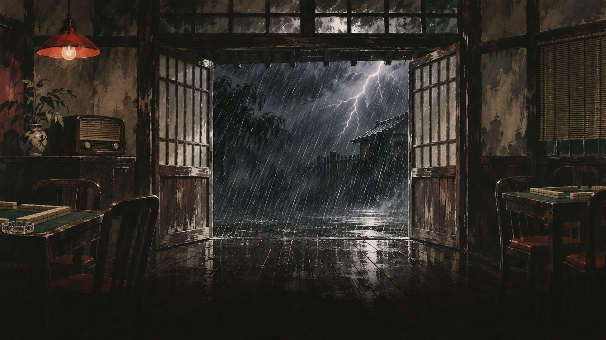

# Akagi — fan game

An unofficial, non-commercial fan game based on *Akagi: The Genius Who Descended into Darkness*
(アカギ ～闇に降り立った天才～) by Nobuyuki Fukumoto: a visual-novel **Story Mode** and a riichi mahjong
**Battle Mode**, playable in **Japanese, Chinese (Simplified) and English**.

**▶ Play in your browser: <https://lyycfairy.github.io/hlg-mahjong/>**

[中文说明](#中文) · [日本語](#日本語)

## How to play

- **Online** — open the link above. Nothing to install.
- **Offline** — download this repository (*Code → Download ZIP*), unzip it and open `index.html` in a
  browser. There is no build step and it needs no network connection.

Pick the language from the dropdown on the title screen; the choice is remembered. Progress is saved in
your browser. Mouse and touch both work; a desktop or tablet screen is the most comfortable, a phone is
playable but cramped. New to riichi mahjong? The title screen has a five-minute **How to Play** page.

## What is in it

- **Story Mode** — Chapter 1, *The Stormy Night*: a man gambling his life in a back-room game, and the
  boy who walks in from the rain.
- **Battle Mode** — two stages, *The Stormy Night* and *The Substitute*. Clearing a stage unlocks the next.
- **Decision scenes** — when the story reaches a discard that matters, the table is laid out with the real
  hand, and every tile shows where it leads: ready or not, the waits and how many are left, what the hand
  pays, and how dangerous the tile is. A commentary goes with it in text and, if your browser has a voice
  for the language, aloud.
- **Opening decisions** — each match starts in the middle of its first hand, at a moment from the story.
  What you choose changes the rest of the match and the story told afterwards.
- **Skills and rage gauges** — anyone with a skill has a gauge that fills as they draw, call, declare
  riichi, win or get hit. A full gauge fires the skill, with a cut-in.
- **Three kinds of opponent** — the *aggressor* attacks, the *collaborator* plays for a team-mate, the
  *independent* plays his own game by the numbers. The briefing before each stage says who is which.
- **Voices** — every character line is voiced in Japanese, Chinese and English, each character with a voice
  of his own chosen for his age and manner, and the players call riichi, pon, chi, ron and tsumo aloud.
  The **Voice** button in the story toolbar and at the table turns voices off; ▶ in the backlog replays a line.

## Mahjong rules

Four-player riichi mahjong: riichi, double riichi and ippatsu; tsumo and ron; pon and chi; furiten; dora and
ura dora; the standard yaku up to yakuman; fu, honba, riichi sticks, noten payments and dealer repeats.

Not in the game yet: kan (and the yaku that depend on it), red fives, abortive draws, nagashi mangan, and
double ron — one discard has one winner.

## About the content

- The story text is an original retelling written for this project in all three languages. It follows the
  events of the source but does not reproduce the manga's or anime's dialogue.
- The artwork is AI-generated (GPT Image) from original written descriptions; it does not copy the manga's
  or anime's drawings. Mahjong tile faces are drawn in code and the sound effects are synthesised.
- The voices are synthesised. Akagi, Nangou and Ryuzaki are voiced with [IndexTTS 2.5](https://github.com/index-tts/index-tts)
  (bilibili) from voices designed for this game from written descriptions with Qwen3-TTS, so no real person's voice
  was copied; the other characters use Microsoft Edge's neural text-to-speech voices. None of them are the anime's
  voice actors or imitate them.
- The IndexTTS recordings are outputs of the bilibili IndexTTS model, used under the bilibili Model Use License
  Agreement (a copy is in `assets/voice/LICENSE-IndexTTS.txt`). As that licence requires: Any modifications made to
  the original model in this Derivative Work are not endorsed, warranted, or guaranteed by the original right-holder
  of the original model, and the original right-holder disclaims all liability related to this Derivative Work.
- No official artwork, music or footage is included. Please keep it that way if you share the game.

*Akagi* © Nobuyuki Fukumoto / Takeshobo. This project is a fan work and is not affiliated with or endorsed
by the rights holders.

## What is in this repository

Only the files needed to play:

| | |
| --- | --- |
| `index.html` | the page that starts the game |
| `css/` | styles |
| `js/` | the game: mahjong rules and computer players in `js/mahjong/`, story and stage scripts in `js/data/`, screens in `js/ui/` and `js/story/` |
| `assets/` | backgrounds, portraits, interface pieces, skill effects, and the voice recordings in `assets/voice/` |

---

## 中文

《アカギ ～闇に降り立った天才～》（福本伸行）的**非官方、非商业同人游戏**：视觉小说式的**故事模式**，加上日本立直麻将的
**对战模式**。支持**中文、日语、英语**，可在标题画面右上角切换。

**▶ 在线游玩：<https://lyycfairy.github.io/hlg-mahjong/>**

- **离线游玩**——下载本仓库（*Code → Download ZIP*），解压后用浏览器打开 `index.html` 即可，无需安装，也不需要联网。
- **内容**——故事模式第一章《暴风雨之夜》；对战模式两关（过一关开启下一关）；抉择场景会摆出真实手牌，并分析每一张牌的
  走向（是否听牌、听哪些牌、打点、危险度），配有文字和语音解说；每场对局从一个来自故事的开局抉择开始；
  技能与怒气槽；三种类型的对手（进攻型、协作型、独立型）；所有角色台词均有中、日、英三语配音，每个角色的声音按年龄和性格挑选。
- **不会打麻将？** 标题画面里有五分钟入门的“游戏说明”。
- **尚未实现**——杠、赤宝牌、途中流局、流局满贯、一炮多响。

故事文本为本项目原创的改写，美术由 AI 根据原创文字描述生成，配音为语音合成：赤木、南乡、龙崎由 IndexTTS 2.5 根据为本作文字设计的声音生成（未复制任何真人声音），其他角色使用微软 Edge 神经网络语音，均非动画声优，未使用任何官方素材。
《アカギ》© 福本伸行／竹书房。本作为同人作品，与版权方无任何关联。

## 日本語

福本伸行『アカギ ～闇に降り立った天才～』を題材にした、**非公式・非営利のファンゲーム**です。ノベル形式の
**ストーリーモード**と、リーチ麻雀の**対局モード**があります。**日本語・中国語・英語**に対応しており、タイトル画面で
切り替えられます。

**▶ ブラウザで遊ぶ：<https://lyycfairy.github.io/hlg-mahjong/>**

- **オフラインで遊ぶ**——このリポジトリをダウンロード（*Code → Download ZIP*）して展開し、`index.html` をブラウザで
  開いてください。インストールもネット接続も不要です。
- **内容**——ストーリーモード第一章「嵐の夜」。対局モードは二ステージ（クリアすると次が開きます）。決断の場面では
  実際の手牌が卓に並び、どの牌を切るとどうなるか（テンパイかどうか、待ち、打点、危険度）が文字と音声の解説つきで
  示されます。各対局は物語の一場面——開局の決断——から始まります。スキルと怒気ゲージ、三タイプの相手
  （攻撃型・連携型・単独型）。登場人物のセリフはすべて日・中・英の三言語でボイスつき。声は年齢と人柄に合わせて一人ずつ選んでいます。
- **麻雀が初めての方へ**——タイトル画面に、五分でわかる「遊び方」があります。
- **未実装**——カン、赤ドラ、途中流局、流し満貫、ダブロン。

ストーリーの文章は本作のために書き下ろした再話で、絵は独自の文章による説明から AI が生成したものです。ボイスは音声合成です。
アカギ・南郷・竜崎は本作のために文章から設計した声をもとに IndexTTS 2.5 で生成し（実在の人物の声は使っていません）、ほかの登場人物は
Microsoft Edge のニューラル音声を使っています。いずれもアニメの声優ではありません。公式の素材は一切使用していません。『アカギ』© 福本伸行／竹書房。本作はファン作品であり、権利者とは一切関係ありません。
