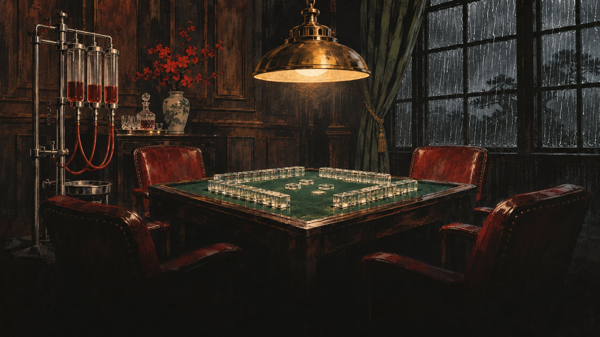

# Akagi — fan game

An unofficial, non-commercial fan game based on *Akagi: The Genius Who Descended into Darkness*
(アカギ ～闇に降り立った天才～) by Nobuyuki Fukumoto: a visual-novel **Story Mode** and a riichi mahjong
**Battle Mode**, playable in **Japanese, Chinese (Simplified) and English**.

**▶ Play in your browser: <https://lyycfairy.github.io/hlg-mahjong/>**

[中文说明](#中文) · [日本語](#日本語)

## How to play

- **Online** — open the link above. Nothing to install.
- **Offline** — download this repository (*Code → Download ZIP*), unzip it and open `index.html` in a
  browser. There is no build step and it needs no network connection.

Pick the language from the dropdown on the title screen; the choice is remembered. Progress is saved in
your browser. Mouse and touch both work; a desktop or tablet screen is the most comfortable, a phone is
playable but cramped. New to riichi mahjong? The title screen has a five-minute **How to Play** page.

## What is in it

- **Prologue — 人血麻将** ("human-blood mahjong"; **Chinese only for now**). Start here if you have
  never met the series. 1965, a rainstorm, the mansion of Washizu Iwao, "the monster of Showa": six hanchan of
  *transparent* mahjong — three copies of every tile are glass, so the other hands show through — and between
  Akagi and Washizu alone, 1,000 points are 100cc of Akagi's blood or a million of Washizu's yen. 2,000cc is
  death. It follows the anime's Washizu arc (episodes 16–26): Akagi demanding the stakes be raised tenfold, the
  riichi-and-feed, the "second river", the 5m ambush, the transfusions he refuses, the 1p trap and the basin of
  blood. Every decision that matters is yours, and each road the story did not take ends in an ending of its
  own (five of them, each with a way back). The key hands are not summarised but played out on a square
  mahjong table seen from Akagi's chair - the ponds in the middle, every hand along its own edge - move by move,
  with the tiles Akagi is reading lit up; through every dialogue a bar shows the blood drawn and left, Akagi's
  winnings and Washizu's shrinking funds; and whenever blood is lost the drawing scene plays: the men in black,
  the needle in the arm, and four 500cc glass cylinders filling to the exact amount, the heartbeat quickening as
  the lethal line nears. Settlements show the stand beside Washizu's remaining money, a bundle of banknotes for
  every ten million yen. Two matches are yours to play at the glass table: the 5m ambush (请君入瓮) and the
  fifth hanchan at 1,400cc (人血麻将). Their partners really play as partners: Yasuoka and Suzuki give up their
  own hands, hold the tiles their man needs, feed him on riichi or under threat, and give the enemy nothing.
- **Not a mahjong player?** Every match in the story has a **Skip match** button (in the briefing and at the
  table): the story simply goes on.
- **Story Mode** — Chapter 1, *The Stormy Night*: a man gambling his life in a back-room game, and the
  boy who walks in from the rain. Chapter 2, **瞒天过海** ("deceive the heavens to cross the sea"): Akagi's
  first hanchan, the police at the door, and a hand built out of the discards while every eye is on the
  doorway. Chapter 3, **借刀杀人** ("kill with a borrowed knife"): the alibi, the restart, and the triple yakuman
  with a detective at the table to witness it. Chapter 4, **见微知著** ("from one small sign, the whole"): the
  dora thrown straight at Ryuzaki's riichi, "the three voices of the discards", and the glance that gives his wait
  away. Chapter 5, **釜底抽薪** ("take the firewood from under the pot"): the hired professional Yagi arrives and
  only watches, while the boy throws away a pair of red dragons to kill a Big Three Dragons and holds the 8s his
  neighbour is waiting for until it is a triplet in his own hand. Chapter 6, **欲擒故纵** ("let go, in order to
  catch"): a finger wagered for every 100,000 yen, Yagi's riichi made only to watch the boy flinch, the win Yagi
  lets go by - and the self-drawn mangan Akagi does not declare. Chapter titles are four-character idioms, from
  the Thirty-Six Stratagems where one fits. Chapters 2-3 follow the first episode of the anime and 4-6 the second;
  they are **in Chinese only for now**, the other languages follow once they are final. As in the prologue, their
  hands are played out on the table move by move, and the roads the story did not take can be tried - and lead back.
- **Battle Mode** — the two prologue matches (always open), then six stages: *The Stormy Night*, 瞒天过海,
  借刀杀人, 见微知著, 釜底抽薪 and 欲擒故纵 (all but the first in Chinese for now). Clearing a stage unlocks the next.
- **The limit-hand effect** — whenever anyone wins a hand worth a mangan or more, at a match table or on a table
  in the story, the table gives way to a painted scene with the name of the limit struck across it, and the
  bigger the hand, the grander the scene: the hawk for a mangan (a band across the table), the carp leaping
  the Dragon Gate for a haneman, the tiger for a baiman (from here the whole screen, with lightning and rising
  embers), the phoenix for a sanbaiman, and for a yakuman a moment of darkness and then the dragon in gold, the
  yaku named beneath it - longer and louder again for a double yakuman. Gold when the hand is yours, blood red when
  it is won against you. A click skips it.
- **Skills** — in Chinese every skill is named with a four-character idiom, and the briefing before a match
  explains each skill at the table:
  - **洞若观火** (*Insight*, "to see as clearly as watching a fire") — see through every hand at the table;
    Ryuzaki's watches Akagi and stops him feeding Akagi a winning tile.
  - **时来运转** (*The Flow*, "when the time comes, luck turns") — the next three draws are the best tiles left.
  - **移花接木** (*Sleight of Hand*, "graft one tree's blossom onto another") — Chapter 2: swap any tile in
    hand for any tile in a pond, four times on a full gauge, to make Big Three Dragons plus Four Concealed
    Triplets on a single wait before the police walk in.
  - **浑水摸鱼** (*In the Confusion*, "fish in troubled waters") — Chapter 3: restart while minds are elsewhere,
    and every opponent stops thinking until Akagi's next turn.
  - **明察秋毫** (*Second Look*, "see even the tip of an autumn hair") — the thug's, in Chapter 3: one more look
    at the ponds and the swap is seen.
  - **孤注一掷** (*All In*, "stake everything on one throw") — Akagi's, in the prologue: the blood and the money
    riding on the hand are doubled, both ways.
  - **洪福齐天** (*Heaven's Favour*, "good fortune as high as the sky") — Washizu's luck: two perfect draws.
  - **里应外合** (*Inside Job*, "those inside answer those outside") — the partners' standing trait: they keep
    the tiles their man needs, and the moment he declares riichi they throw him his winning tile.
  - **釜底抽薪** (*Pull the Firewood*) — Akagi's, in Chapter 5: he sees through every opponent, his next three
    draws are the tiles they are waiting on - taken before they can reach them - and none of them can draw his
    own winning tile.
  - **打草惊蛇** (*Beat the Grass*, "beat the grass to startle the snake") — Yagi's, in Chapter 6: a move made
    only to see how the other man reacts. For the rest of the hand its target is shaken: no skill, no reading.
- **Decision scenes** — when the story reaches a discard that matters, the table is laid out with the real
  hand, and every tile shows where it leads: ready or not, the waits and how many are left, what the hand
  pays, and how dangerous the tile is. A commentary goes with it in text and, if your browser has a voice
  for the language, aloud.
- **Opening scenes** — each match starts in the middle of its first hand, at a moment from the story. In
  *The Stormy Night* Akagi takes a cheap win off the very first discard, as he does in the story; in 欲擒故纵
  the choice is yours: trust the reading and throw the 6m into Yagi's riichi, or fold.
- **Skills and rage gauges** — anyone with a skill has a gauge that fills as they draw, call, declare
  riichi, win or get hit. A full gauge fires the skill, with a cut-in. In *The Stormy Night* Akagi plays
  without one, and after that first win Ryuzaki starts watching him: whenever Ryuzaki's gauge is full while
  Akagi is one tile from winning, his **Insight** fires by itself, and for the rest of that hand he will not
  throw a single tile Akagi is waiting on.
- **Four kinds of computer player** — the *aggressor* attacks, the *collaborator* plays for a team-mate, the
  *independent* plays his own game by the numbers, and the *supporter* (the partners of the prologue) plays his
  partner's hand instead of his own. The briefing before each stage says who is which.
- **Voices** — every character line is voiced in Japanese, Chinese and English (the prologue's cast — Washizu,
  Ogi and Suzuki — in Chinese for now), each character with a voice of his own chosen for his age and manner, and the players call riichi, pon, chi, ron and tsumo aloud.
  The **Voice** button in the story toolbar and at the table turns voices off; ▶ in the backlog replays a line.

## Mahjong rules

Four-player riichi mahjong: riichi, double riichi and ippatsu; tsumo and ron; pon and chi; furiten; dora and
ura dora; the standard yaku up to yakuman, which stack (Four Concealed Triplets on a single wait counts double); fu, honba, riichi sticks, noten payments and dealer repeats.

Not in the game yet: kan (and the yaku that depend on it), red fives, abortive draws, nagashi mangan, and
double ron — one discard has one winner.

## About the content

- The story text is an original retelling written for this project in all three languages. It follows the
  events of the source but does not reproduce the manga's or anime's dialogue.
- The artwork is AI-generated (GPT Image) from original written descriptions; it does not copy the manga's
  or anime's drawings. Mahjong tile faces are drawn in code and the sound effects are synthesised.
- The voices are synthesised. Akagi, Nangou and Ryuzaki, and in Japanese and Chinese also Yagi, Yasuoka and the
  yakuza at the table, are voiced with [IndexTTS 2.5](https://github.com/index-tts/index-tts) (bilibili) from voices
  designed for this game from written descriptions with Qwen3-TTS, so no real person's voice was copied. The rest use
  Microsoft Edge's neural text-to-speech voices. None of them are the anime's voice actors or imitate them.
- The IndexTTS recordings are outputs of the bilibili IndexTTS model, used under the bilibili Model Use License
  Agreement (a copy is in `assets/voice/LICENSE-IndexTTS.txt`). As that licence requires: Any modifications made to
  the original model in this Derivative Work are not endorsed, warranted, or guaranteed by the original right-holder
  of the original model, and the original right-holder disclaims all liability related to this Derivative Work.
- No official artwork, music or footage is included. Please keep it that way if you share the game.

*Akagi* © Nobuyuki Fukumoto / Takeshobo. This project is a fan work and is not affiliated with or endorsed
by the rights holders.

## What is in this repository

Only the files needed to play:

| | |
| --- | --- |
| `index.html` | the page that starts the game |
| `css/` | styles |
| `js/` | the game: mahjong rules and computer players in `js/mahjong/`, story and stage scripts in `js/data/`, screens in `js/ui/` and `js/story/` |
| `assets/` | backgrounds, portraits, interface pieces, skill effects, and the voice recordings in `assets/voice/` |

---

## 中文

《アカギ ～闇に降り立った天才～》（福本伸行）的**非官方、非商业同人游戏**：视觉小说式的**故事模式**，加上日本立直麻将的
**对战模式**。支持**中文、日语、英语**，可在标题画面右上角切换。

**▶ 在线游玩：<https://lyycfairy.github.io/hlg-mahjong/>**

- **离线游玩**——下载本仓库（*Code → Download ZIP*），解压后用浏览器打开 `index.html` 即可，无需安装，也不需要联网。
- **序章《人血麻将》**（目前只有中文）——没接触过原作的玩家请从这里开始。昭和四十年的暴雨夜，“昭和的怪物”鹫巢巌的洋馆：
  麻将牌四张里有三张是透明的玻璃牌，对手的手牌大半一览无余；赤木和鹫巢之间，一千点就是赤木的一百cc血，或鹫巢的一百万日元，抽满两千cc即死。
  根据动画第16–26集的“鹫巢麻将”篇改编：赤木要求把赌注提高十倍、立直后搭档马上喂牌、“第二条牌河”、五万单吊的伏击、两次拒绝补血、一筒的陷阱、
  倒进脸盆的血。关键抉择都交给玩家，偏离原作的路线各有一个原创结局（共五个，都能回到那一刻重选）；
  关键牌局不再用文字概括，而是在一张从赤木座位看过去的方形牌桌上一手一手地演出来（牌河在中央，每家的手牌摆在各自面前），赤木正在读的牌会亮起；
  对话全程显示赤木已抽的血量、离致死量还剩多少、赢得的金额和鹫巢剩下的资金；每次抽血都会播放抽血的场面——黑衣人、扎着针的手臂、
  四根五百cc的量筒按实际的cc数当场涨上去，越接近致死线心跳越急；结算时，量筒旁边会用一捆捆钞票（一捆一千万）显示鹫巢还剩多少钱；
  两位搭档真正作为搭档来打：安冈和铃木不做自己的牌，扣住搭档要的牌，搭档立直或遇险时喂和，对手要的牌一张不给；
  不会打麻将也没关系——故事里的每场对局都有“跳过对局”按钮（对局说明和牌桌上都有），跳过后直接看后面的剧情；
  两场在玻璃牌桌上进行的对局（画面上有抽血量和鹫巢剩下的资金）：南一局的五万伏击《请君入瓮》，以及已抽血一千四百cc时的第五个半庄《人血麻将》。
  新技能：孤注一掷（这一局押上的血与钱翻倍）、洪福齐天（鹫巢的强运）、里应外合（搭档一立直就喂牌）。
- **内容**——故事模式第一章《暴风雨之夜》、第二章《瞒天过海》（警察找上门、所有人望向门口的那一刻，赤木从牌河里掉包，做成大三元＋四暗刻单骑的听牌）、
  第三章《借刀杀人》（不在场证明、浑水摸鱼重开牌局、龙崎打出的西风——三倍役满）；
  第四章《见微知著》（迎着龙崎的立直打出宝牌五索、“舍牌的三种声音”、立直后的一个眼神）、
  第五章《釜底抽薪》（代打矢木到场却只是旁观；赤木拆掉红中对子封死大三元，把上家要和的八索攥成暗刻）、
  第六章《欲擒故纵》（一根手指抵十万的差马、矢木试探用的抢跑立直、故意放过的和牌，以及赤木没有倒下的那手自摸满贯）；
  第二、三章根据动画第一集、第四至六章根据第二集改编，目前只有中文，牌局同样在牌桌上一手一手地演出，原作没走的路也可以试一试再回来。
  对战模式除序章的两场外共六关（过一关开启下一关）。
  **和牌特效**——无论对局还是故事里的牌桌，只要有人和出满贯以上的牌，就会播放一段水墨动画，牌越大场面越大：
  满贯“鹰击长空”、跳满“鱼跃龙门”、倍满“猛虎下山”（从这里起占满整个画面，带闪电和火星）、三倍满“凤凰涅槃”、
  役满则先暗场片刻再现出金色的“飞龙在天”并列出役名，多倍役满更长更响；自己和牌是金色，被别人和是血红色，点击可跳过。
  技能均以四字成语命名，对局前的介绍会逐一解释：洞若观火、时来运转、移花接木、浑水摸鱼、明察秋毫，以及新增的
  釜底抽薪（看穿所有对手，接下来三次摸牌抢先摸走对手正在等的牌，对手自己也摸不到）和打草惊蛇（矢木的技能：这一局里让目标心神动摇，无法发动技能，读牌失灵）；抉择场景会摆出真实手牌，并分析每一张牌的
  走向（是否听牌、听哪些牌、打点、危险度），配有文字和语音解说；每场对局都从故事中的一个场景开始（第一关里赤木照原作那样，
  拿下第一张便宜的和牌；第六关面对矢木的立直，信自己的读牌打出六万还是退，由你抉择）；技能与怒气槽——第一关赤木没有技能，而龙崎在第一局后学会“洞察”：
  怒气槽蓄满时只要赤木听牌就会自动发动，那一局里他绝不会打出赤木所听的牌；四种类型的电脑玩家（进攻型、协作型、独立型，以及序章里只为搭档而打的辅助型）；所有角色台词均有中、日、英三语配音，每个角色的声音按年龄和性格挑选。
- **不会打麻将？** 标题画面里有五分钟入门的“游戏说明”。
- **尚未实现**——杠、赤宝牌、途中流局、流局满贯、一炮多响。

故事文本为本项目原创的改写，美术由 AI 根据原创文字描述生成，配音为语音合成：赤木、南乡、龙崎（以及中日文版的矢木、安冈和牌桌上的打手、跟班，中文版序章的鹫巢、仰木、铃木）由 IndexTTS 2.5 根据为本作文字设计的声音生成（未复制任何真人声音），其余使用微软 Edge 神经网络语音，均非动画声优，未使用任何官方素材。
《アカギ》© 福本伸行／竹书房。本作为同人作品，与版权方无任何关联。

## 日本語

福本伸行『アカギ ～闇に降り立った天才～』を題材にした、**非公式・非営利のファンゲーム**です。ノベル形式の
**ストーリーモード**と、リーチ麻雀の**対局モード**があります。**日本語・中国語・英語**に対応しており、タイトル画面で
切り替えられます。

**▶ ブラウザで遊ぶ：<https://lyycfairy.github.io/hlg-mahjong/>**

- **オフラインで遊ぶ**——このリポジトリをダウンロード（*Code → Download ZIP*）して展開し、`index.html` をブラウザで
  開いてください。インストールもネット接続も不要です。
- **序章「人血麻将」**（現在は中国語版のみ）——原作を知らない方はここから。昭和四十年、嵐の夜、「昭和の怪物」鷲巣巌の屋敷。
  各牌四枚のうち三枚がガラスの「透明な牌」で、相手の手牌がほとんど透けて見えます。アカギと鷲巣のあいだでは千点がアカギの血100cc、
  または鷲巣の百万円。2000ccで死。アニメ第16〜26話の鷲巣麻雀編にもとづき、レートを十倍に吊り上げるアカギ、リーチと差し込み、
  「第二の河」、五萬単騎の待ち伏せ、拒み続ける輸血、一筒の罠、洗面器の血を描きます。重要な決断はすべてプレイヤーに委ねられ、
  原作と違う道にはそれぞれ独自の結末があります（五つ。どれもその場面に戻れます）。要の局は文章ではなく、アカギの席から見た正方形の卓の上で
  一打ずつ再現されます（中央に河、各自の前に手牌）。会話のあいだも採血量・致死量までの残り・獲得金額・鷲巣の資金が常に表示され、採血のたびに
  採血の場面——黒服の男たち、針を刺した腕、500ccのシリンダー四本——が流れ、実際の量まで血が満ちていきます。精算では鷲巣の残り資金を札束（一束1000万円）で
  表示。相棒の安岡と鈴木は自分の手を捨てて相棒のために打ちます。麻雀がわからない方のために、物語中の対局にはすべて「対局をスキップ」ボタンがあります。ガラスの卓での対局が二つ（採血量と鷲巣の資金を表示）。
- **内容**——ストーリーモード第一章「嵐の夜」、第二章「瞞天過海」、第三章「借刀殺人」（第二・三章はアニメ第一話にもとづき、現在は中国語版のみ。
  刑事の来訪に乗じて河の牌をすり替え、大三元・四暗刻単騎のトリプル役満を作る）。第四章「見微知著」（竜崎のリーチにドラの五索を通す、「捨て牌三種の声」、
  リーチ後の視線）、第五章「釜底抽薪」（代打ちの矢木が現れるが、まずは見ているだけ。アカギは中の対子を落として大三元を封じ、上家の当たり牌の八索を暗刻にして握りつぶす）、
  第六章「欲擒故縦」（指一本十万の差し馬、アカギの反応を見るための先制リーチ、見逃されたアガリ、そしてアカギが倒さなかったツモ満貫）。
  第四〜六章はアニメ第二話にもとづき、こちらも現在は中国語版のみです。対局モードは序章の二局のほかに六ステージ（クリアすると次が開きます）。
  **アガリ演出**——対局でも物語の卓でも、満貫以上の手がアガられると水墨画の演出が入り、手が大きいほど派手になります（満貫は鷹、跳満は登龍門の鯉、
  倍満は虎で画面全体に、三倍満は鳳凰、役満は一瞬の暗転のあと金色の龍と役名。自分のアガリは金、相手のアガリは血の赤。クリックで飛ばせます）。
  新しいスキルは「握り潰し」（釜底抽薪：全員の手を見抜き、相手の当たり牌を先に引き取る）と、矢木の「揺さぶり」（打草驚蛇：その局のあいだ相手はスキルも読みも使えない）。決断の場面では
  実際の手牌が卓に並び、どの牌を切るとどうなるか（テンパイかどうか、待ち、打点、危険度）が文字と音声の解説つきで
  示されます。各対局は物語の一場面から始まります（第一ステージではアカギが原作どおり
  最初の安い当たり牌でアガり、第六ステージでは矢木のリーチに対して自分の読みを信じるかどうかを自分で決めます）。スキルと怒気ゲージ——第一ステージのアカギはスキルを持たず、
  最初の局のあと竜崎が「看破」を身につけます。怒気ゲージが満タンのときアカギがテンパイすると自動で発動し、その局のあいだ
  竜崎はアカギの当たり牌を一枚も切りません。四タイプのコンピューター
  （攻撃型・連携型・単独型、序章の相棒は援護型）。登場人物のセリフはすべて日・中・英の三言語でボイスつき。声は年齢と人柄に合わせて一人ずつ選んでいます。
- **麻雀が初めての方へ**——タイトル画面に、五分でわかる「遊び方」があります。
- **未実装**——カン、赤ドラ、途中流局、流し満貫、ダブロン。

ストーリーの文章は本作のために書き下ろした再話で、絵は独自の文章による説明から AI が生成したものです。ボイスは音声合成です。
アカギ・南郷・竜崎（日本語版と中国語版では矢木・安岡・卓のチンピラと子分も、中国語版の序章では鷲巣・仰木・鈴木も）は本作のために文章から設計した声をもとに IndexTTS 2.5 で生成し
（実在の人物の声は使っていません）、ほかは Microsoft Edge のニューラル音声を使っています。いずれもアニメの声優ではありません。公式の素材は一切使用していません。『アカギ』© 福本伸行／竹書房。本作はファン作品であり、権利者とは一切関係ありません。
